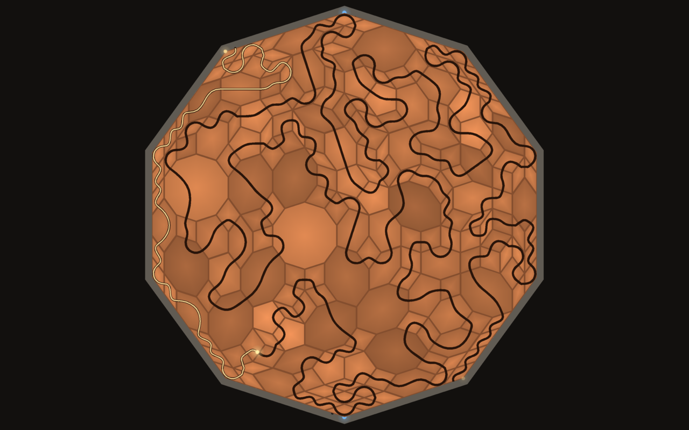

# Teglon

A solver and screensaver for the Teglon, the tiling problem in Neal Stephenson's
novel *Anathem*.

## The problem

In the novel the Teglon is played on the Decagon, a ten-sided plaza in front of the
temple at Orithena. What the book gives:

- The plaza is a regular decagon.
- There are seven moulds, so seven shapes of tile. One of them is a rhombus whose
  obtuse angle fits exactly into a corner of the decagon.
- Every tile has a groove running from one of its sides to another.
- The decagon must be paved completely, building outward from one vertex, so that
  the grooves join into a single unbroken curve from that vertex to the one
  directly opposite, and the curve crosses every tile.
- The tiles are aperiodic: no pattern repeats, so a choice made in one place
  constrains tiles far away.

The book never says what the seven shapes are or where their grooves run, so any
program has to fill that in.

## How this program fills it in

**The seven shapes.** A corner of a regular decagon is 144 degrees, so the natural
tiles have unit sides and angles that are multiples of 36 degrees. There are
exactly seven convex polygons like that:

| # | Shape | Sides | Angles |
|---|-------|-------|--------|
| 0 | thin rhomb | 4 | 36, 144 |
| 1 | thick rhomb | 4 | 72, 108 |
| 2 | regular pentagon | 5 | 108 |
| 3 | long hexagon | 6 | 72, 144, 144 |
| 4 | squat hexagon | 6 | 108, 108, 144 |
| 5 | octagon | 8 | 108, 144, 144, 144 |
| 6 | regular decagon | 10 | 144 |

The thin rhomb is the book's rhombus: its 144 degree corner fills a corner of the
plaza. The two rhombs are the Penrose rhombs, the real-world aperiodic tiles the
Teglon is modelled on.

**The grooves.** A groove joins the midpoints of two sides of a tile. By default
any two sides may be joined, so tiles of one shape come with different grooves.

The stricter reading, one fixed groove per shape, is also implemented
(`teglon-solve -g`). With these seven shapes it turns out to be almost unsolvable.
Searching every possible choice of grooves exhaustively:

| Decagon side | Result |
|---|---|
| 2 | solvable (21 tiles) |
| 3, 4, 5, 6 | no solution for any choice of grooves |

Each of those searches fails within about twenty tiles of the first vertex, so the
obstruction is local to the corner and larger decagons should fail the same way.
That is a computed result for this set of shapes, not a statement about the novel.

### Where the puzzle comes from

Nobody has published a reconstruction of the Teglon tiles, and there is nothing
definite to reconstruct. In his acknowledgments Stephenson says the Decagon
problem was inspired by Peter Lu and Paul Steinhardt's study of girih tilings in
Central Asian mosques, that its details are "altogether fictional", and that a
mathematician could probably prove his version ridiculous.

The girih tiles are the closest thing to a source: five unit-sided shapes with
angles in multiples of 36 degrees (decagon, long hexagon, bow tie, 72/108 rhombus,
pentagon), decorated with strapwork lines that cross the middle of every side and
run on from tile to tile. Four of the five are among the seven shapes above; the
fifth, the bow tie, is not convex. It is available as shape 7 (`-m`).

Fixed-groove results with the bow tie added, every groove layout tried:

| Shapes | Side 2 | Side 3 | Side 4 |
|---|---|---|---|
| the five girih tiles | none | none | none |
| girih five + thin rhomb | none | none | none |
| girih five + thin rhomb + squat hexagon | solvable | none | none |
| girih five + thin rhomb + octagon | none | none | none |
| all eight | solvable | none | none |

The five girih tiles alone cannot even pave a side-3 decagon edge to edge.

## How it solves

1. **Paving.** The decagon is paved as the dual of a pentagrid (de Bruijn's
   construction): five families of parallel lines, and every point where lines
   cross becomes a tile. Two lines crossing give a rhomb, three a hexagon, four an
   octagon, five a decagon. Line positions are drawn from a quasicrystal so that
   many lines meet at common points. Some octagons are then split into two
   pentagons and two thin rhombs.
2. **Groove.** The groove is a path through neighbouring tiles from the first
   vertex to the opposite one that visits every tile once. It is grown from the
   first vertex; whenever its end is boxed in, the path is rewired by reversing its
   tail, which moves the end elsewhere without dropping a tile.
3. **Check.** Every answer is verified independently of the search: tiles inside
   the decagon, no overlaps, total area equal to the decagon's, and the groove
   walked from vertex to vertex counting every tile.

Decagons up to side 24 (about 3,900 tiles) solve in well under a second.

## The screensaver

Every tile has its groove on it before it is set down. `teglon` plays two kinds
of round, each new solution laid over the last in a different tile: terra-cotta,
green, brown, and white porcelain with a black glazed line, as at Elkhazg in the
book.

- **The strict game** (every third round, on a side-2 Decagon): seven moulds, one
  fixed groove each. You watch the real search: tiles tried, lifted and tried
  again until every groove meets its neighbour.
- **A large Decagon**, where a shape may carry its groove between any two sides.
  Tiles go down one after another along the curve, each continuing the groove of
  the last. When the curve is boxed in, tiles are lifted and others with different
  grooves are put in their place.

When a round is solved, light runs down the groove from the first vertex to the
last.

    teglon                  full screen on every display; any key or mouse movement quits
    teglon --window         in a window; Esc or Q quits
    teglon --min 3 --max 7  range of decagon sizes
    teglon --speed 2        faster
    teglon --strict         only the strict game; --no-strict for never
    teglon --snapshot out.bmp --time 40 --size 1920x1080

### Linux

Install the `.deb` or `.rpm`, then turn the screensaver on for your session:

    teglon-screensaver enable 5     # start after 5 minutes idle
    teglon-screensaver disable
    teglon-screensaver status

Wayland desktops have no screensaver service, so this starts `swayidle` at login to
run `teglon` when the session goes idle. It works on compositors that provide the
ext-idle-notify protocol: KDE Plasma, Sway, Hyprland, niri, COSMIC, labwc and
others. GNOME does not provide it. It does not lock the screen.

### Windows

Run `Teglon-Setup-1.0.2.exe`. It installs for the current user without
administrator rights, makes Teglon the current screensaver, and offers to open
Screen Saver Settings. Uninstall from Apps or the Start menu.

## The solver

    teglon-solve -n 6 --svg out.svg       solve side 6 and draw it
    teglon-solve -n 12 -r 1 -p 0.3        -r: more large tiles, -p: share of pentagons
    teglon-solve -n 2 -g 01,12,01,xx,25,xx,05      strict puzzle, fixed grooves
    teglon-solve -n 3 -g xx,xx,xx,xx,xx,xx,xx -b 0 strict puzzle, try every groove layout

Output is one line for the decagon (`D side x0 y0 ... x9 y9`), then one line per
tile in the order the groove visits them
(`P shape sides side_in side_out x0 y0 x1 y1 ...`), then `S`.

## Building

Needs a C compiler, make and SDL2 (2.0.18 or newer).

    make            # build/teglon and build/teglon-solve
    make check      # solve and verify a range of sizes
    sudo make install

Packages are written to `dist/`:

    make deb        # needs dpkg-deb
    make rpm        # needs rpmbuild; packs the current git commit
    make installer  # Windows installer; needs mingw-w64, SDL2 for mingw and NSIS

## Licence

MIT. *Anathem* and the Teglon are Neal Stephenson's; this is an unofficial fan
project.
