# Teglon

A screensaver and solver for the Teglon, the tiling problem in Neal Stephenson's
novel *Anathem*. Runs on Linux, Windows and macOS.

Its companion, [the Lazy Peregrin](https://github.com/mottipython/lazy-peregrin), is a
second *Anathem* screensaver with its own installers. One of the [Anathem screensavers](https://github.com/mottipython/anathem-screensavers).

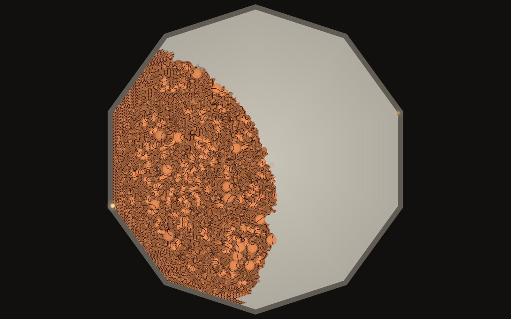

## The problem

In the novel the Teglon is played on the Decagon, a ten-sided plaza in front of the
temple at Orithena:

- The plaza is a regular decagon about two hundred feet across, paved in marble.
- There are seven moulds, so seven shapes of clay tile. One is a rhombus whose
  obtuse angle fits exactly into a corner of the Decagon.
- Every tile has a groove moulded into it, running from one of its sides to another.
- You build the pattern outward from one vertex and pave the whole Decagon so that
  the grooves join into a single unbroken curve from that vertex to the one
  directly opposite, crossing every tile.
- Stretches of groove get left hanging and have to be worked back to. A tile laid
  in one place ends up deciding tiles far away.

## What the screensaver shows

A rhombus goes down in the first corner, its obtuse angle in the vertex, and a tile
at the vertex opposite. Then grooved tiles are laid outward from the first vertex,
carrying the groove on from tile to tile, leaving stretches marooned and joining
them up later. When the last tile is down, light runs along the groove from the
first vertex to the last. The next solution is laid on top in another kind of tile,
as at Elkhazg in the book: terra-cotta, then green, then brown, then white
porcelain with a black glazed line.

| | |
|---|---|
| 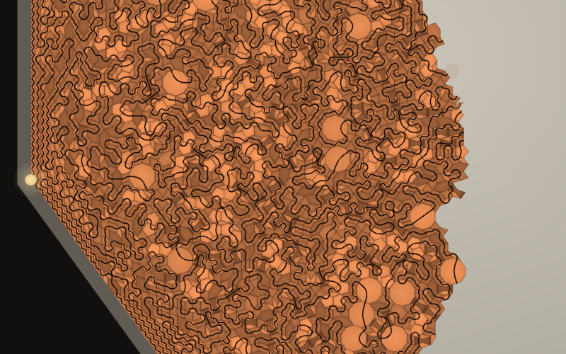 | 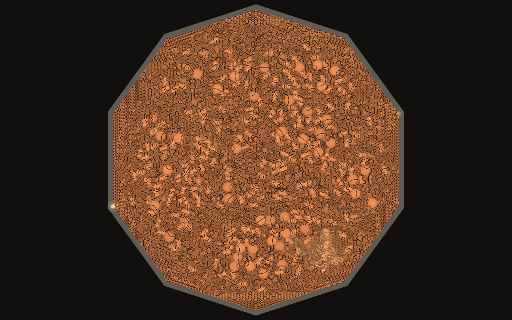 |
| The seven shapes, each in its own colour | Finished: one curve, vertex to vertex |
| 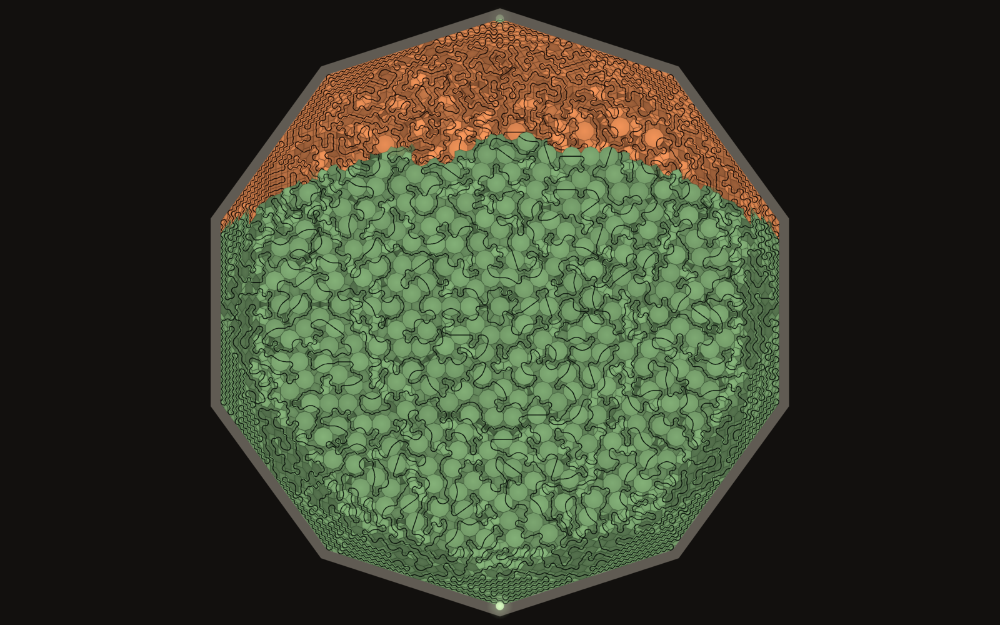 | 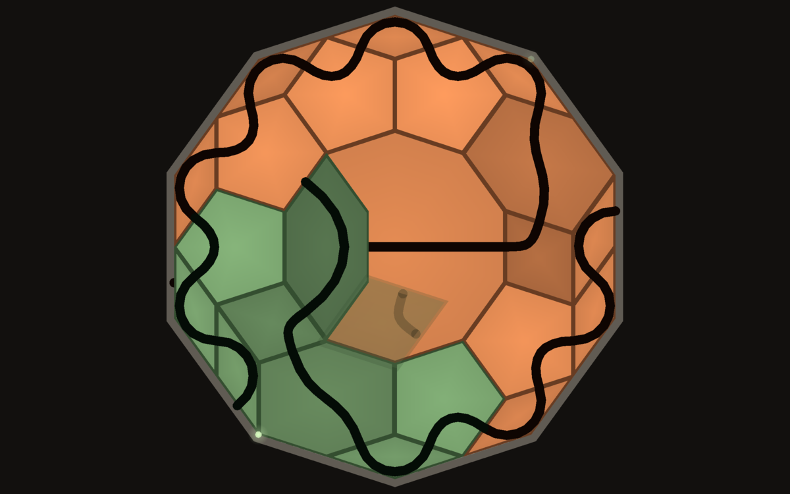 |
| A new solution going down over the last | `--strict`: seven moulds, one groove each |

Every Decagon is solved afresh and no two are the same. The default is 30 tile
edges to a side, about 6,500 tiles, which on a 200-foot plaza makes the tiles
roughly two feet across. The book gives the size of the plaza but not of the
tiles, so that scale is a guess; `--side` changes it.

    teglon                  full screen on every display; any key or mouse movement quits
    teglon --window         in a window; Esc or Q quits
    teglon --side 40        smaller tiles, more of them (up to 48)
    teglon --speed 2        faster
    teglon --strict         the strict game (see below)
    teglon --snapshot out.bmp --time 60 --size 1920x1080

## Gallery

One show from start to finish: four solutions, each laid over the last.

| | |
|---|---|
| 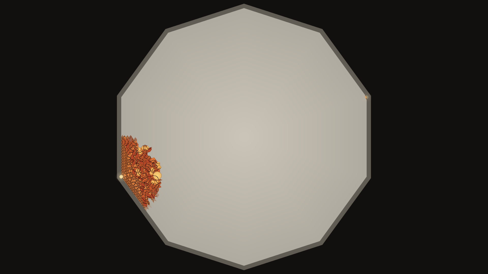 | 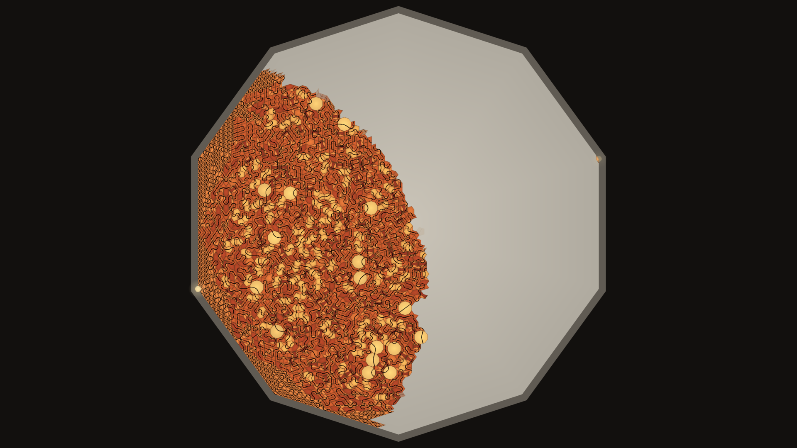 |
| The first tiles on bare marble | About half paved |
| 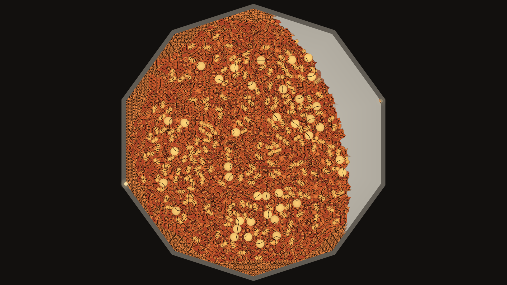 | 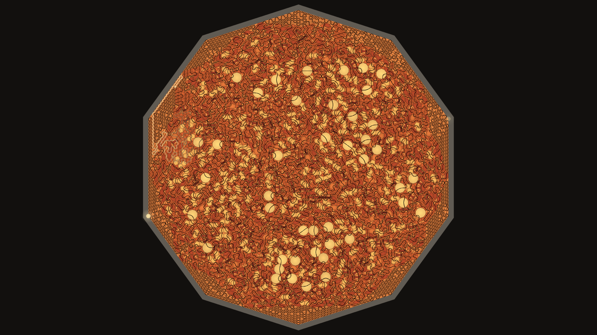 |
| The last corner still open | Finished, light running along the groove |
| 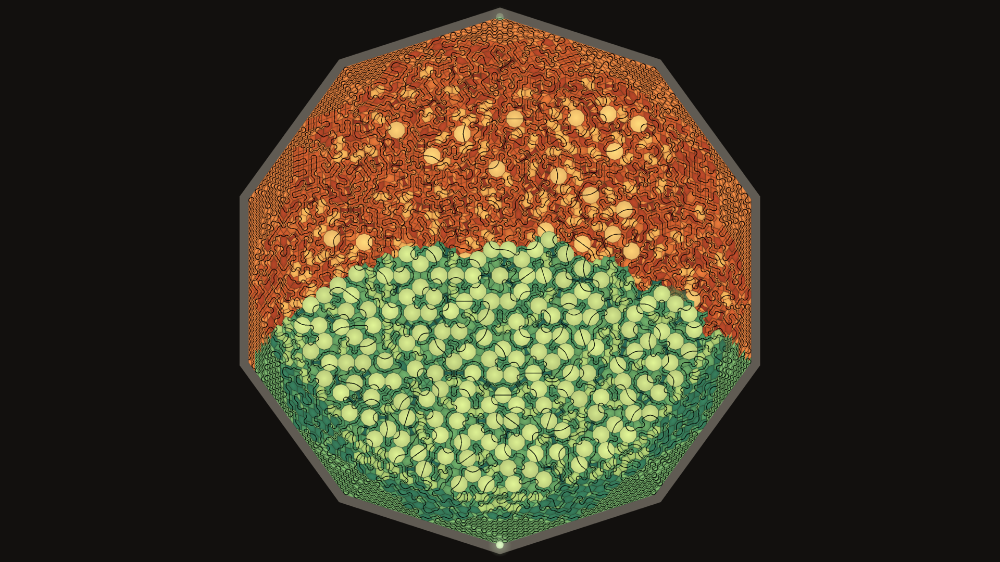 | 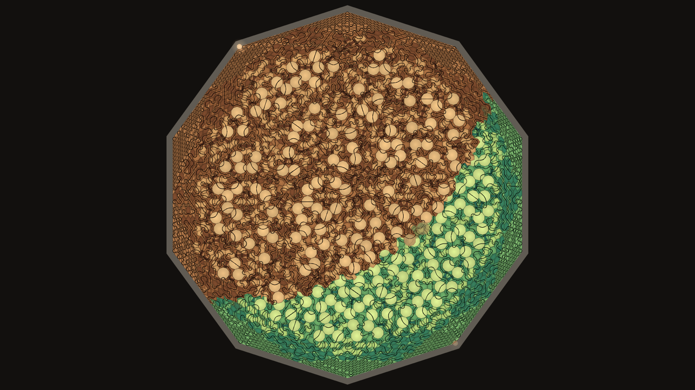 |
| Green going down over terra-cotta | Brown over green |
| 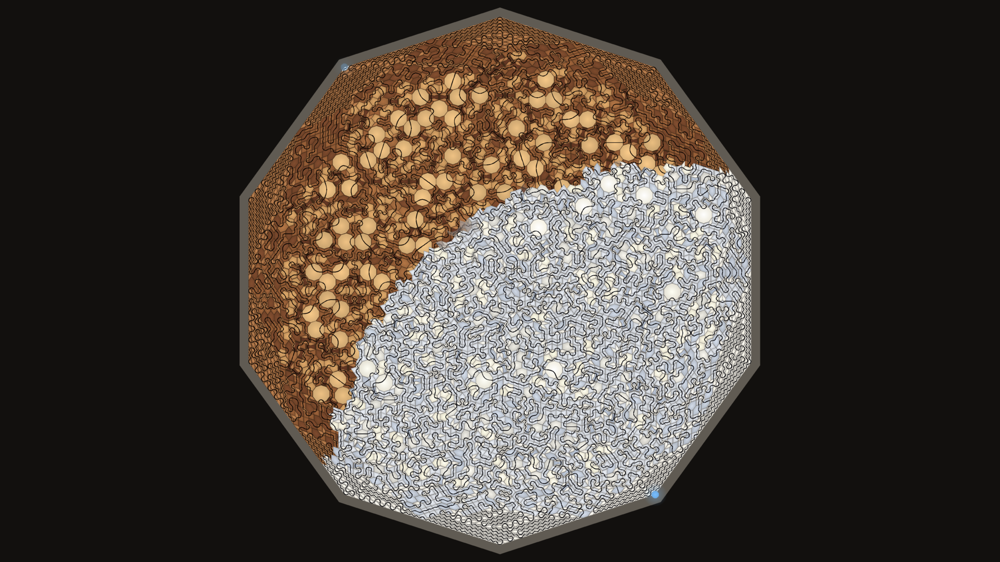 | 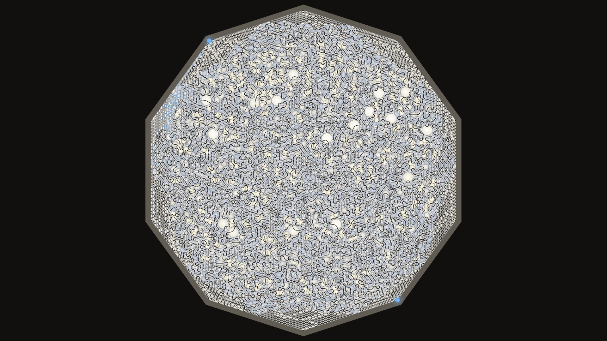 |
| White porcelain with the black line | The finished white Decagon |
| 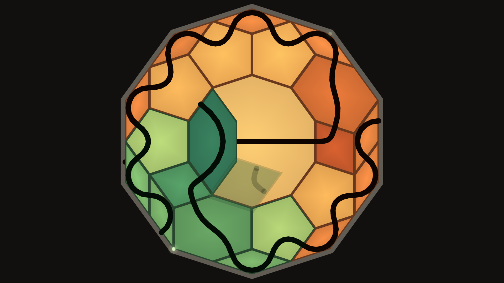 | 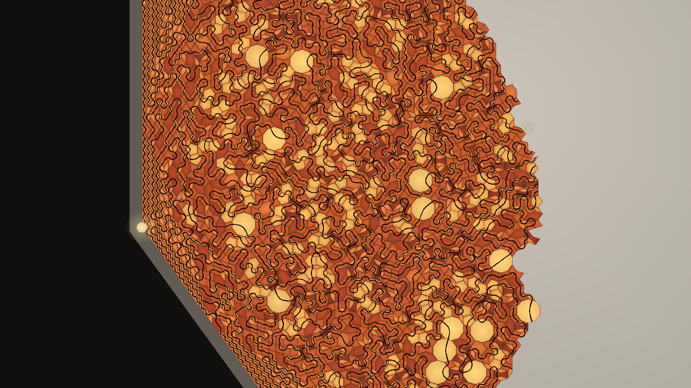 |
| The strict game, solved | Tiles and groove up close |

4K wallpapers: [terra-cotta](docs/screenshots/wallpaper-4k-terracotta.png), [white porcelain](docs/screenshots/wallpaper-4k-white.png).

## Install

Packages are on the [releases page](../../releases).

**Fedora, Nobara** (built on Fedora 44):

    sudo dnf install ./teglon-1.2.0-1.fc44.x86_64.rpm

**Debian, Ubuntu, Mint** (needs glibc 2.35 or newer, i.e. Ubuntu 22.04 / Debian 12 or later):

    sudo apt install ./teglon_1.2.0_amd64.deb

Then turn it on for your session:

    teglon-screensaver enable 5     # start after 5 minutes idle
    teglon-screensaver disable
    teglon-screensaver status

Wayland desktops have no screensaver service, so this starts `swayidle` at login to
run `teglon` when the session goes idle. It works on compositors that provide the
ext-idle-notify protocol: KDE Plasma, Sway, Hyprland, niri, COSMIC, labwc and
others. GNOME does not provide it. It does not lock the screen.

**Windows:** run `Teglon-Setup-1.2.0.exe`. It installs for the current user without
administrator rights, makes Teglon the current screensaver, and offers to open
Screen Saver Settings. Uninstall from Apps or the Start menu. Tried on Windows 11.

**macOS** (Apple Silicon and Intel, macOS 11 or later). The quick way is to paste this into
Terminal. It installs the screen saver for your user and opens the Screen Saver
settings, where it is at the end of the list:

    curl -fsSL https://raw.githubusercontent.com/mottipython/anathem-screensavers/main/tools/mac-install.sh | sh -s -- teglon

Leave off `-s -- teglon` to install all the
[Anathem screensavers](https://github.com/mottipython/anathem-screensavers) at once,
or put `--uninstall` in its place to take them off again.

To do it by hand, download the file ending `-mac-screensaver.zip` from the releases
page, unzip it and double-click the `.saver` file. It is not signed with an Apple
developer certificate, so macOS will refuse it at first: open System Settings,
Privacy & Security, and click Open Anyway. (The command above avoids that step.)
The file ending `-mac.zip` is the same thing as an ordinary app that runs full
screen until you press a key.

Tried on macOS 15 on Intel, where it installs, previews and runs. Not yet tried on
Apple Silicon; reports are welcome.

## The tiles

The book never says what the seven shapes are. In his acknowledgments Stephenson
says the Decagon problem was inspired by Peter Lu and Paul Steinhardt's study of
girih tilings in Central Asian mosques, that its details are "altogether
fictional", and that a mathematician could probably prove his version ridiculous.
Nobody seems to have published a reconstruction.

Girih tiles are five shapes with equal sides and angles in multiples of 36 degrees,
decorated with lines that cross the middle of every side and run on from tile to
tile. A corner of a regular decagon is 144 degrees, and the rhombus that fits it is
the thin Penrose rhomb, which is not a girih tile. So the seven moulds here are:

| # | Shape | Sides | Angles | |
|---|-------|-------|--------|---|
| 0 | thin rhomb | 4 | 36, 144 | the book's rhombus |
| 1 | thick rhomb | 4 | 72, 108 | girih |
| 2 | regular pentagon | 5 | 108 | girih |
| 3 | long hexagon | 6 | 72, 144, 144 | girih |
| 4 | squat hexagon | 6 | 108, 108, 144 | |
| 6 | regular decagon | 10 | 144 | girih |
| 7 | bow tie | 6 | 72, 72, 216 | girih |

(Shape 5, an octagon, is known to the solver but is not one of the seven.)

### Fixed grooves

The book's tiles have their grooves moulded in, one per mould. With these shapes
that turns out to be almost unsolvable. Searching every possible choice of grooves
exhaustively:

| Shapes | Side 2 | Side 3 | Side 4 |
|---|---|---|---|
| the five girih tiles | none | none | none |
| girih five + thin rhomb | none | none | none |
| the seven above | solvable | none | none |
| girih five + thin rhomb + octagon | none | none | none |
| all eight | solvable | none | none |

The seven above are the only seven of the eight that contain the girih tiles and
the book's rhombus and can be solved at all with fixed grooves, on a Decagon two
edges to a side (21 tiles). `teglon --strict` plays that game and shows the real
search, tiles tried and lifted again until every groove meets its neighbour.

For anything larger the screensaver lets a shape carry its groove between any two
of its sides, so there are more than seven moulds. Every tile still has its groove
on it before it goes down. That is the one place this departs from the book, and
these are computed results for this set of shapes, not statements about the novel.

## How it solves

1. **Paving.** The Decagon is paved as the dual of a pentagrid (de Bruijn's
   construction): five families of parallel lines, and every point where lines
   cross becomes a tile. Two lines crossing give a rhomb, three a hexagon, five a
   decagon. Line positions are drawn from a quasicrystal so that many lines meet
   at common points. Octagons are split into two pentagons and two thin rhombs,
   and some squat hexagons into a bow tie and two thin rhombs.
2. **Groove.** The groove is a path through neighbouring tiles from the first
   vertex to the opposite one that visits every tile once. It is grown from the
   first vertex; whenever its end is boxed in, the path is rewired by reversing its
   tail, which moves the end elsewhere without dropping a tile.
3. **Check.** `teglon-solve` verifies every answer independently of the search:
   tiles inside the Decagon, no overlaps, total area equal to the Decagon's, and
   the groove walked from vertex to vertex counting every tile.

## The solver

    teglon-solve -n 6 -x 5 --svg out.svg > /dev/null   solve side 6 with the seven moulds, draw it
    teglon-solve -n 40 -x 5 > /dev/null                 about 11,500 tiles, a couple of seconds
    teglon-solve -n 2 -x 5 -g 01,12,01,xx,25,xx,05,xx   fixed grooves, side 2
    teglon-solve -n 3 -m 0123467 -g xx,xx,xx,xx,xx,xx,xx,xx -b 0   fixed grooves, try every layout

Output is one line for the Decagon (`D side x0 y0 ... x9 y9`), then one line per
tile in the order the groove visits them
(`P shape sides side_in side_out x0 y0 x1 y1 ...`), then `S`.

## Building

Needs a C compiler, make and SDL2 (2.0.18 or newer).

    make            # build/teglon and build/teglon-solve
    make check      # solve and verify a range of sizes
    sudo make install

Packages are written to `dist/`:

    make deb        # needs dpkg-deb
    make rpm        # needs rpmbuild; packs the current git commit
    make installer  # Windows installer; needs mingw-w64, SDL2 for mingw and NSIS

## Licence

MIT. *Anathem* and the Teglon are Neal Stephenson's; this is an unofficial fan
project.
